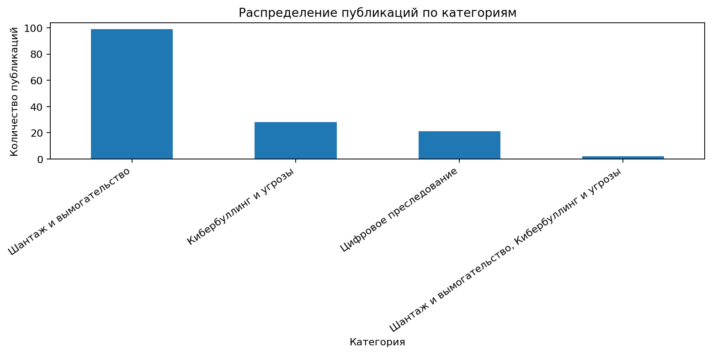

# ◈ DIGITAL HARASSMENT KZ

### Анализ цифровых угроз в Казахстане

**Cybersecurity · Data Analytics · Python**

[📊 Открыть интерактивный дашборд](https://huggingface.co/spaces/ТВОЙ-АККАУНТ/digital-harassment-kz)

[📁 Посмотреть датасет](Digital_Harassment_KZ_dataset.csv)

---

## О проекте

Исследовательский проект для анализа новостных публикаций
о цифровом преследовании, шантаже, кибербуллинге и интернет-мошенничестве
в Казахстане.

## Возможности

- Сбор новостей через RSS.
- Обработка и классификация публикаций.
- Визуализация тематических категорий.
- Поиск и фильтрация публикаций.
- Экспорт данных в CSV.# Digital Harassment KZ

**Анализ цифрового преследования, шантажа и кибербуллинга в Казахстане**

## О проекте

Digital Harassment KZ — исследовательский проект на Python, предназначенный для сбора, обработки и анализа новостных публикаций о цифровом преследовании, шантаже, кибербуллинге, угрозах в интернете и цифровом мошенничестве в Казахстане.

Проект использует публично доступные новостные публикации для изучения того, как казахстанские СМИ освещают проблемы цифровой безопасности.

## Основные возможности

- Сбор новостных публикаций через RSS-ленту Google News.
- Очистка данных и удаление дубликатов.
- Предварительная классификация публикаций по тематическим категориям с помощью ключевых слов.
- Анализ публикаций по категориям и источникам.
- Визуализация результатов с помощью графиков.
- Интерактивный дашборд с поиском и фильтрами.
- Экспорт обработанных данных в CSV.

## Тематические категории

- Шантаж и вымогательство.
- Цифровое преследование.
- Кибербуллинг и интернет-угрозы.
- Распространение интимных материалов без согласия.
- Цифровое мошенничество.

## Используемые технологии

- Python
- Google Colab
- Pandas
- Requests
- BeautifulSoup
- Feedparser
- Trafilatura
- Plotly
- Gradio

## Структура проекта

- `Digital_Harassment_KZ.ipynb` — основной ноутбук с кодом сбора и обработки данных, классификации и визуализации.
- `Digital_Harassment_KZ_dataset.csv` — собранный датасет новостных публикаций.
- `requirements.txt` — список необходимых Python-библиотек.
- `README.md` — описание проекта и инструкция по использованию.

## Датасет

[**Открыть датасет Digital_Harassment_KZ_dataset.csv**](Digital_Harassment_KZ_dataset.csv)

Датасет содержит доступные сведения о публикациях: заголовки, даты, источники, ссылки на оригинальные материалы и тематические категории.

## Визуализация результатов

Графики и интерактивный дашборд позволяют изучать распределение публикаций по тематическим категориям и источникам.

*График будет отображаться здесь после добавления файла `category_chart.png` в корневую папку репозитория.*

## Распределение публикаций по категориям

## Как запустить проект

1. Откройте файл `Digital_Harassment_KZ.ipynb` в Google Colab.
2. Выполните ячейки последовательно, начиная с первой.
3. Дождитесь завершения сбора и обработки публикаций.
4. Изучите построенные графики и откройте интерактивный дашборд.
5. При необходимости скачайте обработанный датасет в формате CSV.

## Ограничения

Классификация основана на ключевых словах и может содержать ошибки. Некоторые публикации могут быть отнесены к неподходящим категориям, а часть релевантных материалов может остаться нераспознанной. Для повышения качества результатов необходима ручная проверка.

Датасет отражает освещение темы в СМИ, а не фактическое количество случаев цифрового преследования в Казахстане. Результаты проекта не предназначены для установления виновности конкретных лиц.

## Конфиденциальность и авторские права

Проект ориентирован на анализ публичных новостных публикаций. При распространении собранных данных необходимо учитывать авторские права, условия использования источников и требования к защите персональных данных. Полные тексты статей не следует публиковать без соответствующего разрешения.

## Возможные улучшения

- Проверка качества классификации на вручную размеченной выборке.
- Расширение словарей ключевых слов на русском и казахском языках.
- Применение методов машинного обучения для классификации текстов.
- Добавление анализа динамики публикаций по датам.
- Расширение возможностей интерактивного дашборда.
